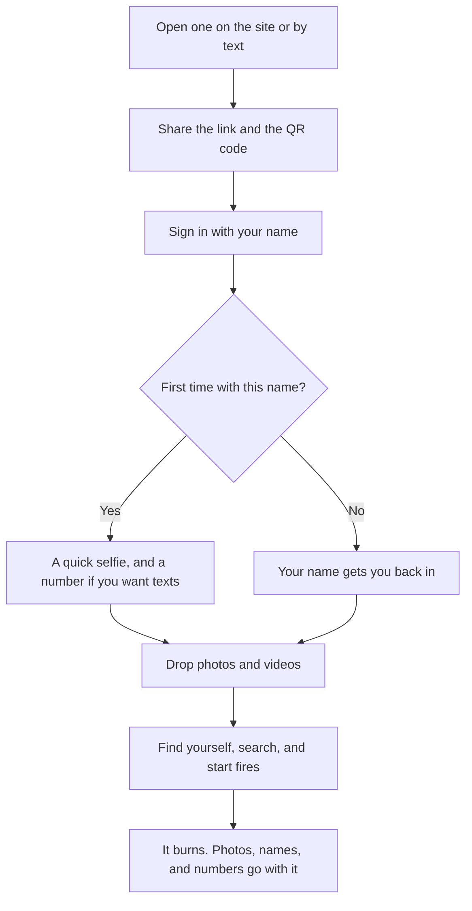
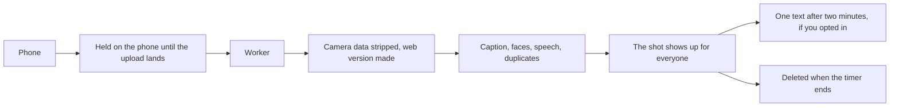
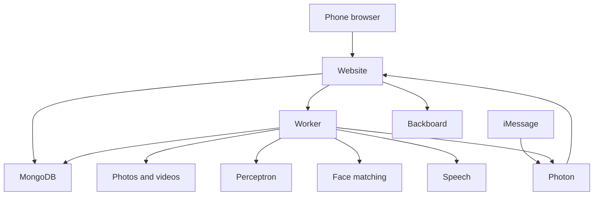

# dump

**Live:** [dumpster.photo](https://dumpster.photo)

dump is one shared photo pile for a group. A party, a hike, a wedding, a tailgate. Someone opens a dumpster, passes the link or the QR code, and everyone dumps in what they shot. It runs in the phone browser, and you can add it to your home screen. There are no accounts. You sign in to that one dumpster, and the sign-in burns with it.

The pile lasts 24, 48, or 72 hours. Then the photos, the videos, the names, and the phone numbers are deleted.

A dumpster has no owner. Nothing records who opened it or who uploaded a shot. Anyone who is signed in can delete any photo or video. People in the photos are visible to everyone in that dumpster. The link is the lock: each id is 25 random characters.

Group chats keep half the photos. A shared album needs the same kind of phone. A drive folder asks every person for space. dump is the bin on the table. Scan the code, dump the pictures, find yourself, and let it go after the weekend.

## How a dumpster goes



Signing in is the door. The pile stays behind it until you have a name on this dumpster.

## Open one

On the home page, name the dumpster, pick 24, 48, or 72 hours, and open it. Videos are on unless you turn them off. You land on its sign-in like everyone else.

Or start by iMessage. Enter your phone number on the home page. dump registers it with Photon if needed, looks up your assigned iMessage number, and opens Messages with a create command ready to send. Edit the name and the hours, then send it. The reply comes back in that conversation with the link and a QR page.

```text
create dumpster "Mt. Si Hike" 48h
```

Pass the link or the QR code around. Joining takes a name. The phone number is only for texts.

A few rules for texts:

- Hours are only 24, 48, or 72. Anything else becomes 24.
- `help` lists the commands.
- A dumpster opened by text takes photos and videos.
- With Backboard configured, a looser text works too, such as "open one for the hike, two days".
- Paste a dumpster link and the reply tells you how many shots are in it, how many fires the top shot has, and when it burns.

Submitting a fresh number uses one of the demo’s 25 iMessage slots. A number that is already registered reuses its slot. If the demo is full, joining by link or QR still works.

## On a phone

A dumpster is six tabs along the bottom: **Drop**, **dump**, **Fire**, **Map**, **Pack**, and **Me**.

### Sign in

Type your name. Names are unique in a dumpster, ignoring capitals and spacing.

- If someone already signed in with that name, dump shows their face and asks whether it is you.
- If nobody has signed in with it, but faces in the pile are already called that, dump shows those faces and asks the same. Yes claims them when you finish.
- A new name goes on to a selfie. Take one or upload one. If it looks like someone already signed in, dump asks whether that is you. If your face is already in the pile, you pick the shots that are you.
- Then an optional phone number, for texts when you show up.

The next time, on any phone, your name alone gets you back in. The selfie is used to find your face and is not kept.

### Drop

Dump photos, and videos when this dumpster allows them. If the signal dies, the phone keeps the files and sends them when it comes back. The same screen has the QR code, **Copy Dumpster link**, and a link to the big-screen view. Each file can be up to 150MB.

### dump

The pile. Faces from the photos and videos sit across the top, named people first.

- Tap a person to see their shots.
- Tap **+ name** under a face to name it. Anyone can, and anyone can fix it. If someone here already has that name, dump shows both faces and asks whether they are the same person. Same moves that face into theirs. Different asks for another name. Only that face moves. A wrong credit does not take away the other person’s sign-in.
- A stranger in the background: tap **+ name** and **Hide face**, or tap their tag on a shot. The face leaves the row and the shots, and new shots of it stay hidden. Only a face nobody has claimed can be hidden. The row ends with **N hidden**. Tap it, then tap the face, to bring it back.
- Type to filter. A word has to show up in the picture, on a sign, in something someone said, in a face’s name, or in a place. Every word in the box has to match.
- Tap the camera next to the search box and search with a photo. A face finds that person’s shots. Anything else finds shots with the same things in them. The search photo is not kept.
- The same photo uploaded twice stays hidden until you tap to show the dupes.
- **All shots** is a grid, newest first by when the shot was taken. A shot with no capture time uses when it was dropped. **Moments** groups shots taken within about 20 minutes and 250 meters of each other, and names the group from the place or the tags.
- Tap **Select** to save shots. On an iPhone or iPad, Save opens the system share sheet so Save Image and Save Video can put the files in the camera roll. Several shots stay separate files. More than 25 come through in batches. On other phones, one shot downloads as a file and several come down as a zip.

If Ask is on, the search box grows an **Ask** button. Ask answers the sentence and shows the shots it means. The word filter still works either way. Ask appears when `BACKBOARD_API_KEY` is set. The key stays on the server.

### Fire

The leaderboard. Open a shot and react. The reactions are the flaming can, a heart, a laugh, wow, a cry, and applause. Tap the flaming can to give it a Dumpster Fire. The shot with the most fires is on top. The other reactions only break a tie, then whoever got there first. The order comes from those taps.

### Map

Every shot with a location, as a thumbnail on a paper-and-ink map. Shots with a fire have an orange edge. Pinch, or use + and −, to zoom. Drag with two fingers so the page can still scroll. The map says so once per sign-in. **Full screen** fills the phone so you can pan with one finger. Under the map, the moments are listed in order. Tap one to flip through it.

The map loads tiles for that area from OpenFreeMap. Those tiles use the same rounded locations already on the pins. Without WebGL, the pins fall back to a grid.

### Pack

Stickers cut out of a photo. Open a shot, tap Sticker, and pick a person, an object, or everyone in the frame. dump removes the background on this machine and draws a white sticker edge. The photo is not sent anywhere to make the sticker.

- On an iPhone, **Add to Stickers** shares one PNG named `sticker.png`. Send it from Messages with the text field empty, touch and hold the sticker, and tap Save to Stickers. It stays in Messages under Stickers.
- The same share sheet still sends that PNG to WhatsApp. On other phones the button is **Add to phone**.
- **Download** saves the PNG. Press and hold a sticker in the pack to save it too.
- **Delete** takes a sticker out of everyone’s pack.

### Me

Who you signed in as, and how many shots you are in.

- Change your name or take a new selfie here. Your name goes on your face in the dump. If the new name is already someone’s, dump asks whether you are the same person and merges you if so. The new selfie is not kept.
- Texts are optional. Add your number on the last step of the first sign-in, or later here. Enter your registered demo number, then send the connection message to your assigned number. That message stays the same every time you reconnect. It expires after ten minutes and only works from the number you entered.
- Once you are connected, dump waits two minutes, then texts you once. That text counts the new shots of you. It includes a video you appear in, or one that says the name on your face.
- About two hours before the dumpster burns, everyone connected gets one warning, with the link, so they can save what they want.
- Change your number or disconnect in Me.
- **Sign out** forgets you on this phone only. Type your name to get back in.
- **Forget me** deletes your name, including on your faces, plus the face match and the number. The connection expires with the dumpster either way.

### Open a shot

You see who is in it. Only people are tagged. Captions, writing, objects, and words from a video stay out of that list, and the search box still finds them. Named people come first. Each face is a name, or Unnamed · Person N. Tap an unnamed tag and its face is outlined, so two unnamed people can be told apart. Tap **That’s me** to claim it. The face takes your name, and new shots of it count as yours.

From the shot you can react, save a copy, cut a sticker, or delete it for everyone.

## On a screen at the venue

Open `/your-dumpster-id/stage` on a TV or a projector. Back to the dumpster sits above the QR code, the counts, the countdown, and the current top fire. Under that, every shot is newest first, and the page scrolls for as long as the pile goes.

## When it burns

At the end of the timer, the worker deletes that dumpster’s files, face data, names, phone numbers, reactions, stickers, and Ask assistant. The link starts showing a burned page. MongoDB also expires the records on its own, so they go away even if the worker is down.

The service worker does not cache photos. A phone can still hold a copy it already loaded: previews for up to a day, a full file served from the app’s own disk for up to an hour. A link out to object storage is remembered for two minutes. After the burn, those URLs stop working.

## How a photo gets in



Each model is optional. A photo still publishes if one of them is down. Face matching and speech run on the same machine as the site, with no public port. Captions and Ask call out. The Dumpster Fire board counts taps.



| Piece | Where it runs | What it does |
|---|---|---|
| Website | Next.js 15, React 19, Tailwind CSS 4, installable as a PWA | The phone app, the stage, and the iMessage webhook |
| Worker | Same server | Sorts uploads, sends texts, and burns expired dumpsters |
| Perceptron Mk1.5 | Hosted | Objects, people, writing, a caption, tags, a venue name, and boxes on each photo |
| Face matching | Private, on the server | Groups faces in photos and videos, and matches a selfie. The vectors stay on the server. |
| Speech | Private faster-whisper, on the server | Makes words in a video searchable, and notices when a video says your name |
| Stickers | On the server, BiRefNet | Cuts a person or object out of a shot |
| Backboard | Hosted | Ask, and texts that are not a fixed command. One assistant per dumpster, deleted when it burns. A loose text uses a throwaway assistant that is deleted before the reply goes out. |
| Photon 2.0 | Hosted iMessage | Creates a dumpster from a text, and sends photo alerts, mention lines, and the burn warning. Every send has an idempotency key, so a retry does not double-text. The sender’s number is not stored on the dumpster and is not sent to Backboard. |
| MongoDB | Hosted, separate from the app | Dumpsters, shots, faces, stickers, and reactions, with an expiration on every collection |
| TigerData | Optional | Drops per minute, and a record of each cleanup. Without it, those numbers come from MongoDB. |
| Files | A disk on the server, or Cloudflare R2 | The photos and videos. Local development uses a folder on disk. |

Model calls, entry points, and data flows are in [AI.md](AI.md). The privacy rules for reviewers are in [VEYZL.md](VEYZL.md). CI runs the privacy check and the VEYZL diff review on every pull request and on pushes to main. The build fails if retention is outside 24, 48, or 72 hours, if data could outlive its dumpster, if face data could reach the browser, or if a creator or uploader identity is stored.

## Run it locally

```bash
cp .env.example .env.local
docker compose up -d mongo timescale
npm install
npm run dev
npm run worker
```

The site is at http://localhost:3000. Run the worker in a second terminal. It sorts uploads, sends texts, and deletes expired dumpsters. It reads `.env.local` when that file exists. Variables already set in the environment win.

The first sticker downloads a cutout model, about 214MB, into `.data/models`. After that, cutting someone out runs on this machine.

Face matching is a separate service. The first build downloads the models, about 300MB:

```bash
docker compose up -d face-embed
```

You can click through the app with no API keys.

- Photos still publish. Captions, writing, and object tags show up once Perceptron is set. Faces in photos and videos group once face-embed is running.
- Texts print in the worker console. A text that is not the create command gets the command list.
- Search stays a word filter. The Ask button stays hidden.
- Drops per minute come from MongoDB.
- Files land in `./.data/storage`.

Checks:

```bash
npm run typecheck && npm test && npm run audit:privacy && npm run audit:veyzl
```

`npm run brand` rebuilds the logo files from the SVGs in the repo root.

Try a text locally. The secret below matches `PHOTON_WEBHOOK_SECRET` in `.env.example`.

```bash
curl -X POST localhost:3000/api/photon/webhook -H "content-type: application/json" \
  -H "x-photon-secret: change-me" -d "{\"from\":\"+12065550123\",\"text\":\"Create dumpster \\\"Mt. Si Hike\\\" 48h\"}"
```

Live texts arrive as Photon `message.received` events, signed as Standard Webhooks (`webhook-id`, `webhook-timestamp`, `webhook-signature`). The reply goes back in that same conversation. Ordinary commands do not store the sender’s number. An explicit `connect CODE` message binds a guest’s alerts to that verified conversation until the dumpster expires.

To exercise connection lifecycle tests against a disposable MongoDB, set `TEST_MONGODB_URI` before `npm test`. These tests create and drop a separate `dump_connection_test_*` database. CI supplies its own MongoDB service.

## Production

The live site is [dumpster.photo](https://dumpster.photo). Production is one Vultr machine running the Docker Compose stack in [deploy/README.md](deploy/README.md): the website, the worker, private face matching, and private speech transcription. Caddy sits in front for HTTPS, accepts uploads up to 150MB, and keeps the live photo stream flowing. MongoDB is hosted separately. TigerData and Cloudflare R2 are optional. Face matching and speech have no public port, so only this app can reach them.

The comments in `.env.example` name every variable. Each integration is optional. The app runs without them.
